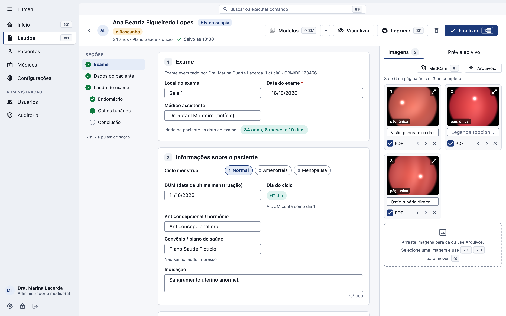
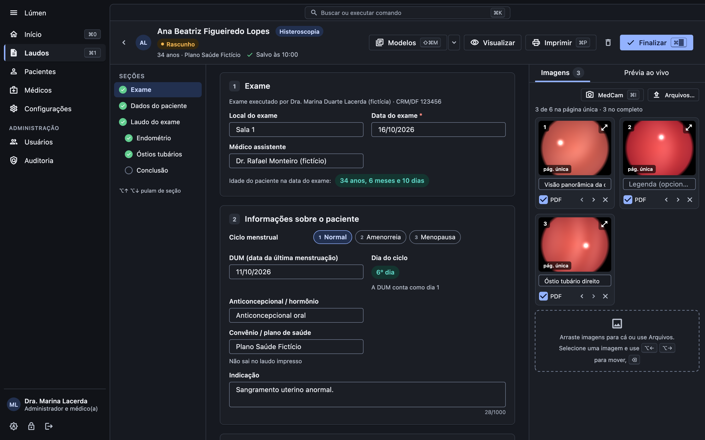
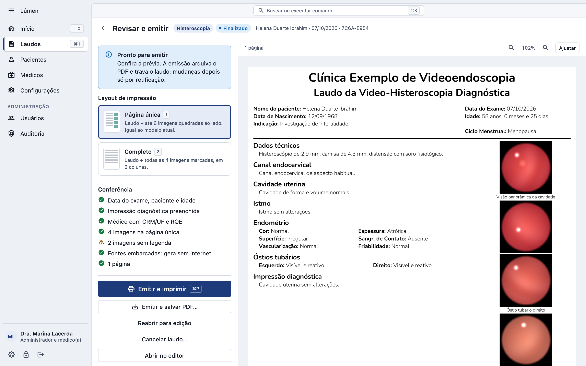
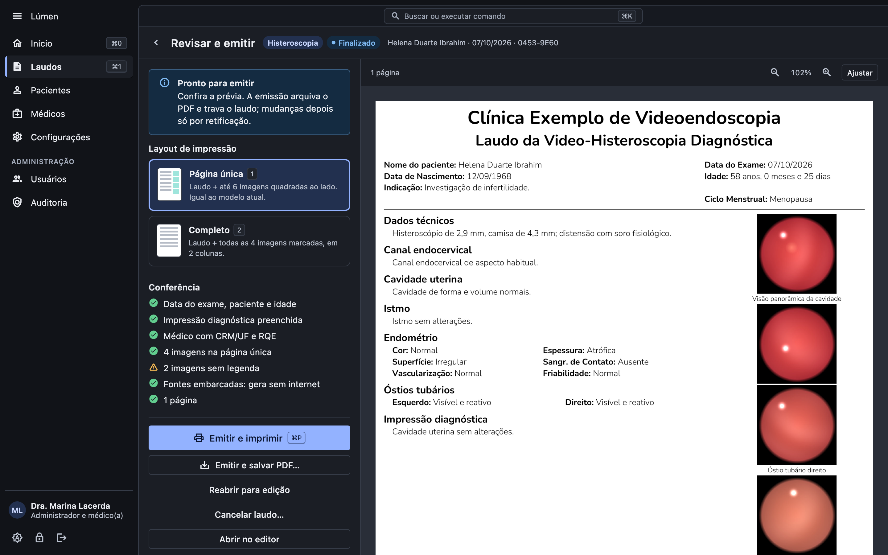
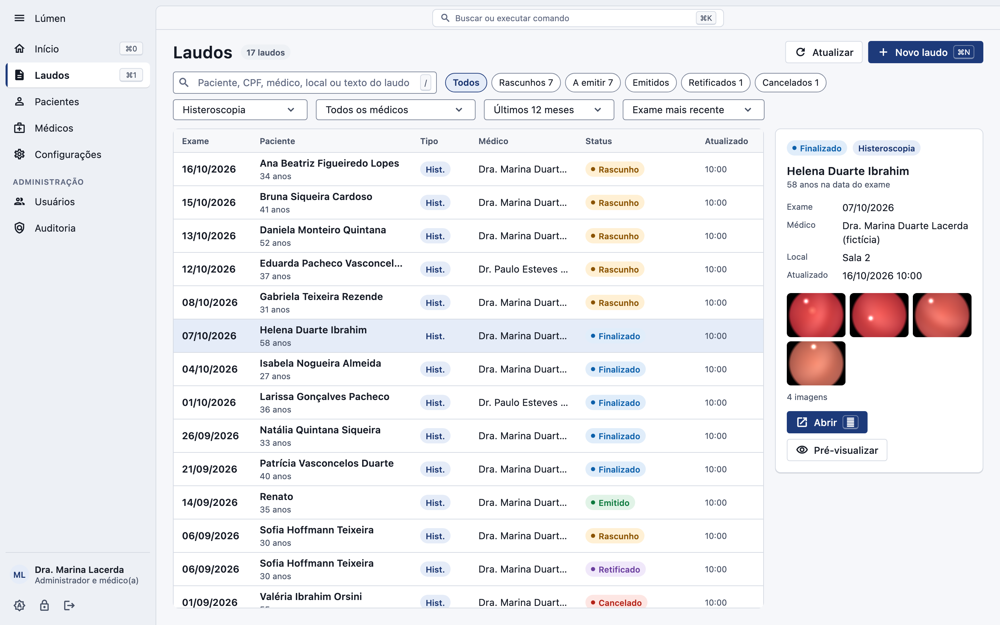
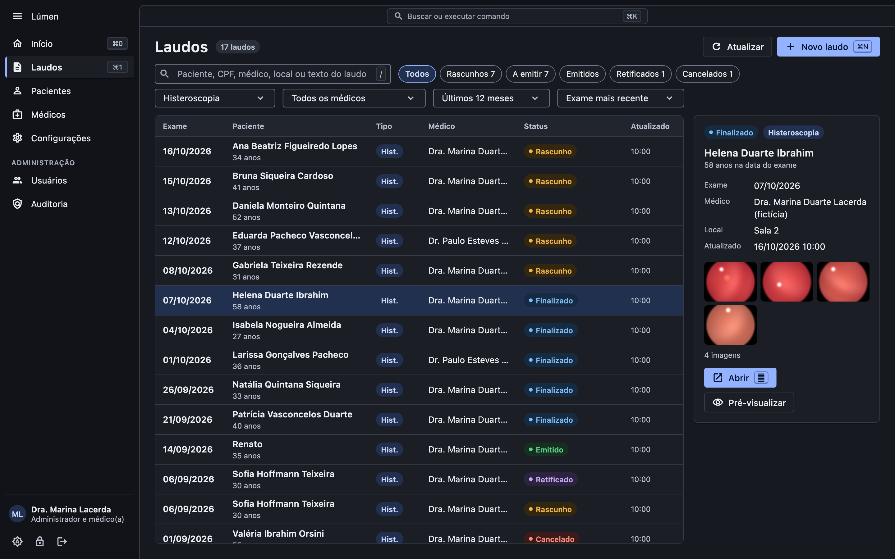

# Lúmen

**Do exame ao laudo emitido.**
Sistema de laudos de histeroscopia e videolaparoscopia da Hallen Tech, para Windows 11 e macOS.

[**lumen.hallentech.com**](https://lumen.hallentech.com)

## O que é

O Lúmen junta, numa janela só, o caminho do laudo: o paciente e o exame, o texto a partir de modelos da clínica ou do próprio médico, as imagens da câmera (MedCam) ou de arquivos, a revisão do PDF no layout da clínica e a emissão arquivada com impressão digital (hash). Reimpressões e retificações ficam registradas.

Tudo roda no computador da clínica, com o banco de dados cifrado, login por usuário, papéis separados (médico, secretária, administrador e suporte), auditoria encadeada e backup automático cifrado.

## Telas

| Claro | Escuro |
|---|---|
|  |  |
|  |  |
|  |  |

Telas com dados fictícios.

## Baixar

A primeira versão pública para Windows 11 sai em breve, assinada pela Hallen Tech; o macOS vem em seguida. Os instaladores de cada versão ficarão na aba [Releases](https://github.com/hallentech/lumen-releases/releases). Para implantar na sua clínica: contato@hallentech.com ou WhatsApp (21) 99697-3923.

## Sobre este repositório

Aqui ficam só a página do produto (pasta `docs/`, publicada em lumen.hallentech.com) e, a partir da primeira versão pública, os pacotes de instalação. O código-fonte do Lúmen não é público.

Lúmen, por <a href="https://hallentech.com">Hallen Tech</a>.

